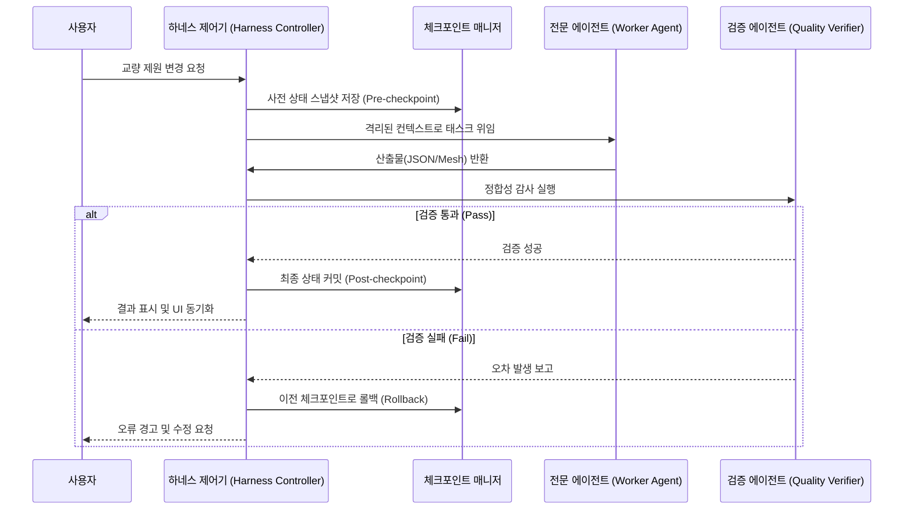

# Anthropic 장기 실행 앱 하네스 (Harness Design) 아키텍처 명세

> **참조 가이드**: [Anthropic Engineering: Harness Design for Long-Running Apps](https://www.anthropic.com/engineering/harness-design-long-running-apps)  
> **프로젝트**: BIM 기반 고속도로 교량 공사비 산정 웹 소프트웨어  

---

## 1. 하네스 설계 3대 핵심 원칙

### 1.1 상태 분리 (State Separation)
* **원칙**: 에이전트의 LLM 컨텍스트 윈도우에 모든 교량 제원 및 연산 이력을 영구 보관하지 않는다.
* **구현**:
  * 교량 파라미터(Red) 및 대안별 상태는 외부 체크포인트 파일(`.claude/harness/checkpoints/*.json`)에 즉시 영속화한다.
  * 컨텍스트 압축이나 세션 재시작 시 체크포인트에서 상태를 복원하여 컨텍스트 드리프트(Context Drift) 및 메모리 누출을 차단한다.

### 1.2 모듈 및 에이전트 격리 (Module Isolation)
* **원칙**: 복합 적산 및 3D 모델링 작업을 단일 모놀리식 프롬프트에서 처리하지 않고 마이크로 에이전트로 완전 격리한다.
* **구현**:
  * `bridge-cost-engine`은 순수 수치 적산만 수행하며 3D 렌더링에 관여하지 않는다.
  * `bim-parametric-modeler`는 형상 지오메트리만 생성하며 적산 단가 조회에 관여하지 않는다.
  * 에이전트 간 데이터 교환은 엄격한 JSON 스키마를 통해서만 단방향으로 전달된다.

### 1.3 오류 복원력 및 멱등성 (Fault-Tolerance & Idempotency)
* **원칙**: 중간 적산 오류나 렌더링 충돌 발생 시 전체 파이프라인이 중단되지 않고 이전 정상 체크포인트로 롤백할 수 있어야 한다.
* **구현**:
  * 모든 적산 연산 함수는 입력값이 동일하면 항상 동일한 결과를 반환하는 순수 함수(Pure function, 멱등성 보장)로 설계한다.
  * `quality-verifier`가 실적 벤치마크 검증 실패를 감지하면 파라미터 조정 전 체크포인트로 안전하게 롤백한다.

---

## 2. 하네스 런타임 제어 주기 (Control Loop)

