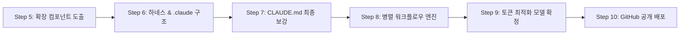

# PLAN.md — 향후 작업 계획 및 우선순위 백로그

> **프로젝트**: BIM 기반 고속도로 교량 공사비 산정 웹 소프트웨어  
> **기준 지침**: `에이전트용_작업지시서_v1.4.0.md`  
> **목표**: Step 순차 실행 프로토콜 준수 및 상태 머신 게이트 기반 고품질 완수  

---

## 1. 단계별 실행 로드맵 및 잔여 백로그 (Forward Roadmap)

### [Step 5] 확장 컴포넌트 도출 (Agent, Command, Skill, Hook) — *Next Action*
* **우선순위**: P0 (필수)
* **세부 작업**:
  * **TASK-5.1 (Agents)**: 5대 전문 에이전트(`bridge-cost-engine`, `bim-modeler`, `alternative-analyst`, `quality-verifier`, `report-generator`)의 상세 스펙/프롬프트 정의
  * **TASK-5.2 (Commands)**: 개발 및 분석 단축 명령어 (`/estimate`, `/compare-alts`, `/verify-benchmarks`, `/export-excel`) 정의
  * **TASK-5.3 (Skills)**: 도메인 연산 스킬 (REV.04 단가 조회, 비선형/선형 보간, 강재가 변동 보정, Three.js 파라메트릭 빌더) 정의
  * **TASK-5.4 (Hooks)**: 입력 파라미터 변경 시 자동 적산 재계산, 정합성 검증 트리거 훅 정의
* **완료 조건 (DoD)**: 컴포넌트 기획안 작성 및 사용자 게이트 승인 획득

---

### [Step 6] Claude Code 구조 구축 및 Anthropic 하네스 설계 반영
* **우선순위**: P0 (필수)
* **참조 가이드**: `https://www.anthropic.com/engineering/harness-design-long-running-apps`
* **세부 작업**:
  * **TASK-6.1**: Anthropic Long-running 앱 하네스 3대 원칙(상태 분리, 모듈 격리, 오류 복원력) 반영
  * **TASK-6.2**: Claude Code 표준에 따른 `.claude/` 디렉터리 트리 생성
  * **TASK-6.3**: Step 5의 에이전트, 커맨드, 스킬, 훅 설정 및 스크립트 파일 구현
* **완료 조건 (DoD)**: `.claude/` 하위 컴포넌트 세트 구축 완료 및 사용자 게이트 승인

---

### [Step 7] 하네스 기반 CLAUDE.md 및 에이전트 구조 보강
* **우선순위**: P1 (고도화)
* **세부 작업**:
  * **TASK-7.1**: 하네스 설계 패턴을 `CLAUDE.md`의 에이전트 상호작용 및 세션 보존 규약에 통합
  * **TASK-7.2**: 다중 에이전트 간 컨텍스트 전달 및 격리 프로토콜 보강
* **완료 조건 (DoD)**: 최종 고도화된 `CLAUDE.md` 승인

---

### [Step 8] 다이나믹 에이전트 워크플로우 구현 및 병렬화
* **우선순위**: P0 (핵심 엔진)
* **세부 작업**:
  * **TASK-8.1**: 교량 개략공사비 엔드투엔드 처리 및 성과품 생산 파이프라인 구현
  * **TASK-8.2**: 상호 의존성이 없는 독립 작업(경간별 적산, 3D 지오메트리 계산, 대안 비교 산출)의 Dynamic Agent 병렬 실행 구성
  * **TASK-8.3**: 파일 락킹 및 경쟁 상태(Race condition) 방지 로직 적용
* **완료 조건 (DoD)**: 병렬 워크플로우 실행 엔진 완성 및 안정성 검증

---

### [Step 9] 토큰 최적화 모델 추천 및 확정
* **우선순위**: P1 (비용 절감)
* **세부 작업**:
  * **TASK-9.1**: 복합 수학/적산/아키텍처(Pro/Sonnet급) vs 보일러플레이트/포맷팅(Flash/Haiku급) 모델 티어 매핑표 작성
  * **TASK-9.2**: 단계별 최적 모델 추천 제안서 작성
* **완료 조건 (DoD)**: 사용자 명시적 컨펌 획득 후 해당 모델 티어 적용

---

### [Step 10] GitHub 공개 저장소 생성 및 최종 배포
* **우선순위**: P0 (최종 배포)
* **세부 작업**:
  * **TASK-10.1**: `.gitignore` 검증 (키, 환경변수, 빌드 산출물 차단)
  * **TASK-10.2**: GitHub 공개 저장소(Public Repository) 생성
  * **TASK-10.3**: 소스 코드 전체 초기 커밋 및 원격 저장소 푸시
* **완료 조건 (DoD)**: 정상 배포된 GitHub 공개 저장소 URL 확인

