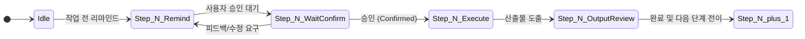

---
# [MACHINE CONFIG] 에이전트 자동 파싱용 프로젝트 파라미터 (YAML)
project:
  name: "BIM 기반 고속도로 교량 공사비 산정 웹 소프트웨어" # [가변] 프로젝트 명칭
  topic: "BIM을 기반으로 한 고속도로의 교량 공사비를 대안별로 산정하여 비교할 수 있도록하는 웹기반 소프트웨어" # [가변] 프로젝트 상세 주제 및 핵심 목표
  domain_type: "Web Application" # [가변] 도메인 유형 (Web Application, Backend API, CLI Tool, Data Pipeline, Desktop App 등)
  reference_path: "docs/" # [가변] 참조 성과품/요구명세서 디렉터리 경로
  reference_targets: ["개략공사비"] # [가변] 품질 검증 기준 대상 산출물 목록
  quality_metric: "정확도 100%" # [가변] 품질 및 정합성 목표 지표
  domain_validation_criteria: "기초자료를 참고하여 산정방법 및 단가 정확도로 판단" # [가변] 도메인 특화 검증 기준 (3D-도면 정합성, API 스키마 일치, 테스트 커버리지 등)
  harness_guide_url: "https://www.anthropic.com/engineering/harness-design-long-running-apps"

# UI/UX 데이터 표현 규칙 (헤드리스/CLI/라이브러리 등 UI가 없는 프로젝트의 경우 enabled: false 처리)
ui_rules:
  enabled: true
  user_input:
    color: "red"
    definition_rule: "단일 위치 정의 (중복 금지)"
  derived_or_calc:
    color: "blue"
  fixed_or_assumed:
    color: "black"

execution_protocol:
  strict_sequential: true
  gate_confirmation_required: true
  context_isolation_required: true
---

# [에이전트 표준 작업지시서] v1.4.0

## 📌 문서 버전 관리 (Version Control)

| 버전(Version) | 변경 일자 | 변경자 | 보존 문서 파일 | 변경 내용 및 사유 | 상태 |
| :--- | :--- | :--- | :--- | :--- | :--- |
| **v1.4.0** | 2026-11-10 | Agent | `에이전트용_작업지시서_v1.4.0.md` | • **주제 가변성 대응 전면 도메인 중립화(Domain-Agnostic Refactoring)** • 특정 도메인(암거/BIM) 하드코딩 제거 및 `project.*` 파라미터 기반 완전 추상화 • UI/UX 규칙의 조건부 활성화(`ui_rules.enabled`) 구조 도입 • 이전 주제 잔류 컨텍스트 오염 방지를 위한 '문맥 격리 규칙(Context Isolation)' 신설 | 현재 최신 버전 |
| **v1.3.0** | 2026-11-10 | Agent | `에이전트용_작업지시서_v1.3.0.md` | 기계 가독성(YAML 블록)과 인간 가독성 동시 만족 하이브리드 리팩토링, 상태 전이 및 금지 규칙 명시 | 아카이브 보관 |
| **v1.2.0** | 2026-11-10 | Agent | `에이전트용_작업지시서_v1.2.0.md` | 프로젝트 가변 파라미터 표 신설, 각 Step별 DoD 규격화, 예외 처리 규칙 보강 | 아카이브 보관 |
| **v1.1.0** | 2026-11-10 | Agent | `에이전트용_작업지시서_v1.1.0.md` | UI/UX 데이터 표현 규칙 및 성과품 품질 기준을 '기본 준수 원칙'으로 통합 재구성 | 아카이브 보관 |
| **v1.0.0** | 2026-11-10 | Agent | `에이전트용_작업지시서_v1.0.0.md` | 작업지시서_R2 기반 에이전트 표준 작업지시서 초안 제정 | 아카이브 보관 |

---

> [!NOTE]
> 본 문서는 **다양한 개발 주제(Web, Mobile, Backend, CLI, AI 등)**에 즉각 적응할 수 있도록 설계된 범용 AI 에이전트 표준 지시서입니다.  
> **[빨간색 텍스트]**는 프로젝트 주제 변경 시 갱신되는 가변 영역이며, 최상단 YAML 블록(`project.*`, `ui_rules.*`)과 1:1로 매핑됩니다.

---

## 1. 프로젝트 가변 파라미터 (Human-Readable Table)

*새로운 주제의 프로젝트를 시작할 경우, 아래 표와 최상단 YAML 설정값만 변경하면 에이전트가 새 주제에 맞춰 자동 적응합니다.*

| 파라미터 Key                                                                                   | 현재 설정 값 (프로젝트별 가변 영역)                                                                                         | 범용 설명 및 기준                                               |
| :----------------------------------------------------------------------------------------- | :------------------------------------------------------------------------------------------------------------ | :------------------------------------------------------- |
| **project.name**                       | BIM 기반 고속도로 교량 공사비 산정 웹 소프트웨어                             | 프로젝트 공식 명칭                                               |
| **project.topic**                      | BIM을 기반으로 한 고속도로의 교량 공사비를 대안별로 산정하여 비교할 수 있도록하는 웹기반 소프트웨어 | 프로젝트의 핵심 개발 주제 및 최종 목표                                   |
| **project.domain_type**                | Web Application                                           | 시스템 유형 (Web App, Backend API, CLI Tool, Data Pipeline 등) |
| **project.reference_path**             | docs/                                                     | 참조 성과품, 요구명세서 또는 기준 문서 경로                                |
| **project.reference_targets**          | 개략공사비                                                     | 유사율 100% 또는 정합성을 검증해야 할 대상 산출물 목록                        |
| **project.quality_metric**             | 정확도 100%                                                  | 성과품 품질 합격 기준 (유사율 100%, 테스트 통과율 100% 등)                  |
| **project.domain_validation_criteria** | 기초자료를 참고하여 산정방법 및 단가 정확도로 판단                              | 도메인 특화 유효성 검증 기준 (예: 3D-도면 정합성, API 스키마 일치 등)            |
| **ui_rules.enabled**                   | true                                                      | UI/UX 규칙 적용 여부 (`false` 시 UI 규칙 생략)                      |
| **project.harness_guide_url**                                                              | `https://www.anthropic.com/engineering/harness-design-long-running-apps`                                      | Anthropic 장기 실행 앱 하네스 가이드                                |

---

## 2. 절대 준수 원칙 (Negative Constraints & Governance Rules)

### 2.1. 절차 준수 및 상태 전이 규칙 (State Machine)

1. **순차 실행 강제**: 모든 절차는 번호 순서(Step 0 → 1 → ... → 10)로만 전이한다. 사전 일괄 실행이나 단계 건너뛰기는 엄격히 금지된다.
2. **작업 전 리마인드 및 승인 게이트**: 각 Step에 진입하기 직전, **"수행할 핵심 작업 내용 리마인드"**를 출력하고 **사용자의 명시적 승인(컨펌)**을 받은 후에만 실제 도구 호출 및 구현을 수행한다.
3. **피드백 루프**: 사용자가 수정이나 보완을 요구하면 요구사항을 즉시 반영하여 재리마인드 후 재승인을 받는다.

### 2.2. 품질 및 데이터 정합성 원칙 (도메인 중립화)
* **목표 성과품 일치성**: 시스템을 통해 생성되는 성과품은 `project.reference_path` 내의 `project.reference_targets`와 비교하여 `project.quality_metric`에 도달해야 한다.
* **도메인 특화 유효성 검증**: 성과품 간 정합성은 `project.domain_validation_criteria`에 명시된 규칙을 기준으로만 엄격히 검증한다.
* **임의 가정 금지 (No Hallucination)**: 기준 데이터나 명세가 불명확할 경우 임의로 수치를 지어내지 않고, 반드시 `project.reference_path`의 기준 문서 또는 사용자의 지시를 확인한다.

### 2.3. UI/UX 데이터 표현 및 단일 출처 원칙 (Single Source of Truth)
> [!NOTE]
> 본 절은 `ui_rules.enabled: true`인 프로젝트에만 필수 적용됩니다. (CLI/백엔드/라이브러리 등 비UI 프로젝트에서는 단일 출처 원칙만 데이터 모델 레벨에서 적용)

* **사용자 입력값 (Red)**:
  * 화면 상에 반드시 **붉은색**으로 표기한다 (폰트 색상 또는 테두리 등).
  * **단일 위치 정의 (SSOT)**: 동일 변수의 입력창을 여러 곳에 분산 배치하는 것을 엄격히 금지하며, 오직 한 곳에서만 정의한다.
* **인용 및 계산값 (Blue)**: 인용된 외부 데이터나 시스템 연산 결과는 **파란색**으로 표기한다.
* **가정값 또는 고정값 (Black)**: 시스템 상수, 고정 파라미터, 기본 가정값은 **검은색**으로 표기한다.

### 2.4. 문맥 격리 및 이전 주제 오염 방지 규칙 (Context Isolation)
* **단일 진실 공급원(SSOT) 준수**: 에이전트는 프로젝트 실행 시 오직 최상단 YAML 블록의 `project.*` 값만을 절대 기준으로 삼는다.
* **이전문맥 잔류 오염 금지**: 이전 세션이나 예시 텍스트에 포함된 과거 도메인 키워드(예: 암거, BIM, 3D 등)를 새 주제에 임의로 유추·혼합하거나 결합하여 환각을 발생시키는 행위를 일체 금지한다.

---

## 3. 단계별 표준 실행 프로토콜 (Execution Protocol)

### [Step 1] 웹 조사 및 에이전트 전략 수립
* **[원문 요구사항]**: {주제}를 만들기를 원한다. 일단 심도 있게 웹 조사를 하고 어떤 방법으로 할지 하나씩 agent를 만드는 작업을 해볼 수 있을까? **무엇을 할지 메모리에 저장해라.**
* **TASK-1.1**: `project.topic` 및 `project.domain_type` 구현을 위한 웹 기술 스택, 최적 아키텍처 및 핵심 라이브러리 심층 조사 수행
* **TASK-1.2**: 주제별 업무 특성에 맞춘 에이전트 분할 및 역할 구성 방안 기획
* **TASK-1.3**: 기획된 로드맵 및 수행할 액션 목록을 세션 메모리에 영구 저장
* **OUTPUT**: 웹 조사 보고서 및 에이전트 분할 전략 (메모리 저장 완료)
* **GATE**: 작업 전 계획 리마인드 $\rightarrow$ 사용자 진행 승인(컨펌) 대기

---

### [Step 2] 기술 구현 고려사항 도출
* **[원문 요구사항]**: 우리가 이러한 {주제}를 기술들을 구현하는 과정에서 고려해야 할 점들은 무엇일까요?
* **TASK-2.1**: `project.reference_targets` 간의 데이터 정합성 보장 및 무결성 유지 난제 분석
* **TASK-2.2**: UI 단일 입력 규칙(SSOT) 및 컬러 코딩 적용에 따른 프론트엔드/상태관리 아키텍처 고려사항 정리 (`ui_rules.enabled` 참조)
* **TASK-2.3**: `project.domain_type` 실행 환경(웹 브라우저, 서버, 분산 엔진 등)에서의 연산 부하 및 성능 최적화 이슈 도출
* **OUTPUT**: 기술 구현 필수 고려사항 분석 보고서
* **GATE**: 작업 전 리마인드 $\rightarrow$ 사용자 확인 및 피드백 대기

---

### [Step 3] 프로젝트 거버넌스 규약 작성 (CLAUDE.md)
* **[원문 요구사항]**: 위를 구현하기 위한 프로젝트를 셋업 하려고 합니다. **지금 셋업을 하지 말고** 이러한 {주제}을 위한 `CLAUDE.md` 작성해주세요.
* **TASK-3.1**: 실제 프로젝트 디렉터리 셋업 및 패키지 설치는 일체 보류 (코드 작성 금지)
* **TASK-3.2**: `project.topic` 개발에 최적화된 `CLAUDE.md` 파일 초안 작성 (컨벤션, 명령어, 아키텍처 규칙, 도메인 제약조건 정의)
* **OUTPUT**: 프로젝트 루트의 `CLAUDE.md` 파일
* **GATE**: 작업 전 리마인드 $\rightarrow$ 작성된 `CLAUDE.md` 내용 사용자 승인 대기

---

### [Step 4] 작업 상태 추적 체계 구축 (PROGRESS.md & PLAN.md)
* **[원문 요구사항]**: 일을 여러 에이전트들이 나눠서 할 때, 어디까지 진행되고 무슨 일을 해야 하는지에 대한 내용들을 각각 `PROGRESS.md` 와 `PLAN.md` 에서 관리하도록 합시다. 그리고 새로 시작할 때 두 파일을 읽어서 내가 무슨 일을 해야 하는지 에이전트들이 알 수 있게 합시다. 이렇게 `CLAUDE.md` 를 업데이트 합시다.
* **TASK-4.1**: 세션 간 작업 진행 상태 및 이력을 추적할 `PROGRESS.md` 생성
* **TASK-4.2**: 향후 남은 작업과 우선순위 백로그를 관리할 `PLAN.md` 생성
* **TASK-4.3**: 모든 에이전트가 세션 시작 시 `PROGRESS.md`와 `PLAN.md`를 필독하도록 `CLAUDE.md` 부트스트랩 지침 갱신
* **OUTPUT**: `PROGRESS.md`, `PLAN.md`, 갱신된 `CLAUDE.md`
* **GATE**: 작업 전 리마인드 $\rightarrow$ 파일 생성 및 지침 갱신 확인 승인 대기

---

### [Step 5] 확장 컴포넌트 도출 (Agent, Command, Skill, Hook)
* **[원문 요구사항]**: 그러면 이제 이런 일들을 할 때 필요한 **에이전트, 커맨드, 스킬, Hook** 들이 무엇이 있을지 고민해 보고, 아이디어들을 알려주세요.
* **TASK-5.1**: `project.topic`의 기능 단위별 전문 에이전트(예: 코어 모델러/엔진, 산출물 생성기, 정합성 검증기 등) 역할 정의
* **TASK-5.2**: 개발 및 운영 생산성 향상을 위한 단축 명령어(Commands) 아이디어 정의
* **TASK-5.3**: 외부 시스템 연동 및 특화 계산/처리를 위한 스킬(Skills) 정의
* **TASK-5.4**: 성과품 정합성 검증 및 파일 상태 갱신을 자동 트리거할 훅(Hooks) 정의
* **OUTPUT**: 확장 컴포넌트(에이전트/커맨드/스킬/훅) 상세 기획안
* **GATE**: 제안된 컴포넌트 목록에 대한 사용자 승인 대기

---

### [Step 6] Claude Code 구조 구축 및 Anthropic 하네스 설계 반영
* **[원문 요구사항]**: 그러면, Claude code의 agent, command, skill, hook 구조를 조사한 후, 그에 따라서 정확한 포맷을 지켜서 `.claude` 하위에 위에서 제안한 것들을 만들어 주세요.  
  * **단, 추가 하네스**: 이제 “ [https://www.anthropic.com/engineering/harness-design-long-running-apps](https://www.anthropic.com/engineering/harness-design-long-running-apps) ” 이 사이트를 읽으세요.
* **TASK-6.1**: Anthropic Long-running 앱 하네스 원칙(상태 분리, 모듈 격리, 오류 복원력) 학습 및 프로젝트 아키텍처에 적용
* **TASK-6.2**: Claude Code 표준 규격에 맞추어 `.claude/` 디렉터리 구조 생성
* **TASK-6.3**: Step 5에서 확정된 에이전트, 커맨드, 스킬, 훅의 실제 설정/실행 파일 생성
* **OUTPUT**: `.claude/` 하위 컴포넌트 파일 세트
* **GATE**: 작업 전 리마인드 $\rightarrow$ 생성된 하네스 구조 사용자 확인 및 승인 대기

---

### [Step 7] 하네스 기반 CLAUDE.md 및 에이전트 구조 보강
* **[원문 요구사항]**: 이 방향으로 `CLAUDE.md` / 에이전트 구조를 보강해 주세요.
* **TASK-7.1**: 하네스 설계 패턴을 `CLAUDE.md`의 에이전트 상호작용 규칙에 통합 반영
* **TASK-7.2**: 다중 에이전트 간 컨텍스트 전달 및 격리 프로토콜 최종 보강
* **OUTPUT**: 최종 고도화된 `CLAUDE.md`
* **GATE**: 작업 전 리마인드 $\rightarrow$ 보강 내역 사용자 승인 대기

---

### [Step 8] 다이나믹 에이전트 워크플로우 구현 및 병렬화
* **[원문 요구사항]**: 지금까지 작성한 계획으로 workflow 를 구현하세요. 다이나믹 agent를 사용하여 병렬화가 가능한 부분은 병렬로 해주세요. 병렬로 하더라도 안정된 구현을 해주기 원합니다.
* **TASK-8.1**: `project.topic`의 엔드투엔드 처리 및 성과품 생산 엔지니어링 파이프라인 구현
* **TASK-8.2**: 상호 의존성이 없는 독립 작업(예: 하위 산출물 생성, 검증, 렌더링/빌드 등)에 Dynamic Agent를 배치하여 병렬 실행 구성
* **TASK-8.3**: 파일 락킹 및 경쟁 상태(Race condition) 방지 로직을 구현하여 동시성 안정성 보장
* **OUTPUT**: 안정성이 검증된 병렬 워크플로우 실행 엔진
* **GATE**: 작업 전 리마인드 $\rightarrow$ 워크플로우 구현안 사용자 승인 대기

---

### [Step 9] 토큰 최적화 모델 추천 및 확정
* **[원문 요구사항]**: **토큰 절약**을 위해서 구현단계에 **최적 모델을 추천하고 컨펌을 받고 진행**한다.
* **TASK-9.1**: 태스크 성격(고난도 아키텍처/수학 vs 단순 포맷팅/보일러플레이트)에 따른 모델 티어 매핑표 작성
* **TASK-9.2**: 비용 및 토큰 소모를 최소화할 수 있는 단계별 모델 추천안 제시
* **OUTPUT**: 단계별 최적 모델 추천 제안서
* **GATE**: 사용자에게 추천안 제시 $\rightarrow$ **사용자 명시적 컨펌(승인) 획득 후 구현 진행**

---

### [Step 10] GitHub 공개 저장소 생성 및 최종 배포
* **[원문 요구사항]**: 웹서비스를 위해 **github공개저장소** 만들고 커밋과 푸시를 한다.
* **TASK-10.1**: `.gitignore` 파일 검증 (API 키, 환경변수 파일 `.env`, 빌드 산출물 누출 차단)
* **TASK-10.2**: GitHub 공개 저장소(Public Repository) 생성
* **TASK-10.3**: 소스 코드 전체 초기 커밋(Commit) 및 원격 저장소 푸시(Push)
* **OUTPUT**: 정상 배포된 GitHub 공개 저장소 URL
* **GATE**: 최종 배포 완료 보고 및 검증

